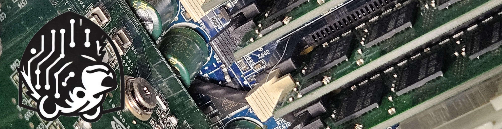

[Linkedin](https://www.linkedin.com/in/chrisbrownbt603/).


# Bio
I'm Chris. IT enthusiast, novice homelabber; passionate about learning and passing on whatever I can.
I've been working in or around the IT industry for a couple of years, but I have been on a tech journey (whether I knew it or not) for most of my life.
I have always been big on technology in its various forms: computers, gaming, audio, video; and more recently homelabbing, networking, and cybersecurity.

-

## It's not much, but it's a start
This is my first foray into the world of websites, so bear with me. This page is very much under construction and probably will be for the foreseable future.

-

### More to come, if all goes well
As time goes on, I'll be adding projects, writeups, and maybe tutorials or blogs. For right now, just getting this thing off the ground is the plan.

- <a href="https://medium.com/@bearabletechtv/bearable-tech-it-support-ticket-01010426-32aea2968607" target="_blank" rel="noopener noreferrer">First Write Up</a>
This write up is an IT support project for a family friend. Simple, basic, remedial even? Sure. But the job needed doing, so here is the unnecessarily long documentation.
- <a href="https://medium.com/@bearabletechtv/bearable-tech-it-support-ticket-02101026-2778a76fbabc" taget="_blank" rel="noopener noreferrer">Second Write Up<a/>
This write up is an IT repair project involving a problematic Joy-Con controller. Another easy fix made difficult!

```
Thanks for stopping by!
```
My Current TryHackMe Progress!
<iframe src="https://tryhackme.com/api/v2/badges/public-profile?userPublicId=2551873" style='border:none;'></iframe>
...
